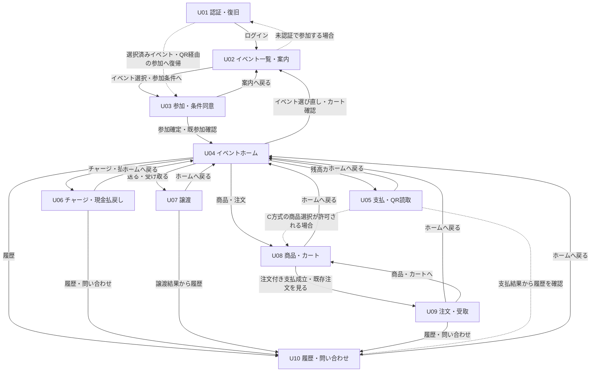

# 設計書：来場者画面一覧・画面遷移

| 項目 | 内容 |
| --- | --- |
| 状態 | 下書き |
| 担当 / レビュー者 | 未決 / 未決 |
| 更新日 | 2026-10-15 |
| 関連要件ID / 受入試験ID | 各画面は [visitor.md](visitor.md) を参照。横断：ROL-02、ROL-03、JOIN-01、UI-01、UI-02、UI-03、UI-04、UI-07、NET-02 / AT-008、AT-010、AT-037、AT-068 |
| 関連Issue / PR / ADR | 本書の関連Issue・PR・承認ADRは未決 |

## 目的・対象範囲

来場者向けU01〜U10の役割と画面間の導線を定義する。画面内の一覧・詳細・確認・結果・問い合わせ、確認ダイアログは同じ画面ID内の状態として扱う。運営・受付・レジ・主催者の画面設計は本書の対象外とする。

本書は正式な画面設計成果物の下書きであり、実装完了・受入合格・設計承認を示すものではない。今回の更新は設計確認用プロトタイプの分離に伴う参照先・位置付けの整理であり、U01〜U10と既存の業務上の画面遷移・設計内容は変更しない。

### 参照資料と優先関係

| 資料 | 本書での扱い |
| --- | --- |
| [UI設計の案内](README.md)、[設計書テンプレート](../../templates/design.md) | 文書の対象・構成 |
| [要件定義](../../requirements/event_payment_requirements.md) 第5〜20・26章、UI-07、付録A | 業務制約・必須画面・受入試験の根拠 |
| [基本設計](../basic-design.md) 第11〜13・16・19〜22・28・35章 | 画面ID、導線、確認・異常時の設計、未決事項 |
| [詳細設計](../detailed-design.md) 第10〜14・23章 | 状態・期限・正本の照会、未決事項の引継ぎ |
| PR #35の`prototypes/visitor-ui-design`の設計確認用プロトタイプ：[App.tsx](../../../prototypes/visitor-ui-design/src/App.tsx)、[VisitorScreens.tsx](../../../prototypes/visitor-ui-design/src/VisitorScreens.tsx)、[README・起動方法](../../../prototypes/visitor-ui-design/README.md) | U01〜U10の設計・クリック遷移確認用。通常の`apps/web`の起動・buildから分離した参考実装。MOCKのデータ・固定タイマー・実装範囲を正式仕様・受入完了の根拠にしない |
| [PR #25](https://github.com/fespay-team/fespay/pull/25)の別参考実装：[prototype/（cdc0d3f）](https://github.com/fespay-team/fespay/tree/cdc0d3fb86bad42d0f5d346d581f13a401258af6/prototype) | 未マージ（2026-10-15確認）。より具体的な操作体験・表示配置・画面内操作のUI参考。認証・取引成立・期限検証などの正式仕様・承認・受入完了の根拠にしない |
| [PR #20](https://github.com/fespay-team/fespay/pull/20)の説明資料：[Prototype.md（fc5897f）](https://github.com/fespay-team/fespay/blob/fc5897fbf9a9e367447941d982d4d6d9f4ecfcca/docs/design/Prototype.md) | 未マージ（2026-10-15確認）。PR #25のデモ範囲を説明する参考資料。設計・要件・受入試験の承認を示さない |

要件定義を優先し、基本設計・詳細設計で具体化する。プロトタイプと相違する場合は既存要件・設計に従う。不明点は「未決」とし、氏名・金額・イベント名・照合番号などのMOCK値を固定しない。

PR #20・#25の参照は、上記のPRと確認済み固定コミットに限定する。未マージの`prototype/`や`docs/design/Prototype.md`がmainに存在する前提の相対リンクは使わない。両参考実装の範囲は [visitor.md](visitor.md) の「参考実装との対応」で分けて記載し、片方で未実装であることを理由に必要画面・機能を削除しない。

PR #35はU01〜U10全体の設計・遷移確認、PR #25はデモ送金・チャージ・履歴保存等の具体的な操作体験の確認を目的とする。どちらも正式仕様・受入完了の根拠にはしない。正式な来場者画面の組込み・API接続は [Issue #28](https://github.com/fespay-team/fespay/issues/28) / [Issue #29](https://github.com/fespay-team/fespay/issues/29)で行い、今回の分離作業では実装しない。

## 設計

### 来場者画面一覧

| 画面ID | 画面名 | 役割 | 主な画面内状態 |
| --- | --- | --- | --- |
| U01 | 認証・復旧 | 本人の登録・認証・認証方法管理・復旧を行う | 登録、メール確認、ログイン、再設定、認証連携、全端末ログアウト |
| U02 | イベント一覧・案内 | イベントを探し、開催情報・参加条件・払戻し条件を確認する | 一覧・検索、イベント案内 |
| U03 | 参加・条件同意 | 条件版への同意と、必要な参加パスワードの検証を経て参加する | 未参加の条件確認、既参加の判定、参加結果 |
| U04 | イベントホーム | 選択中イベントの本人残高と各機能への入口を示す | 通常表示、更新中・通信不可、イベント切替確認 |
| U05 | 支払・QR読取 | B方式QR提示、A/C方式読取、本人の支払確認・承認・結果照会を行う | QR表示・読取、会計確認、処理中、結果確認中、成立・拒否・期限切れ |
| U06 | チャージ・現金払戻し | 受付で対象者を照合し、チャージ結果と払戻しの本人確認・承認・状態を確認する | 受付用QR、チャージ結果、払戻し額確認、拘束・交付・調査状況 |
| U07 | 譲渡 | 同一イベントの参加者間で、受取QR提示と送信者の照合・明示承認を行う | 入口、受取QR、読取、相手確認、金額入力、確認、結果 |
| U08 | 商品・カート | 店舗別の商品を選択し、カート編集から見積・在庫確認・支払承認へ進む | 店舗・商品一覧、カート、注文・支払確認、結果確認中 |
| U09 | 注文・受取 | 本人の注文内容・提供状況・返金状況と受取用情報を確認する | 注文一覧、注文詳細、受取画面 |
| U10 | 履歴・問い合わせ | 本人の取引検索・詳細確認と問い合わせに必要な情報を示す | 取引一覧、取引詳細、問い合わせ先・追跡ID |

各画面の項目・操作・例外・要件ID・受入試験IDは [visitor.md](visitor.md) を正本とする。

### 基本遷移と戻り導線

本図は正本に基づく既存の業務上の画面遷移を維持する。実線は`prototypes/visitor-ui-design`の設計確認用プロトタイプで確認できる画面間導線、破線は既存要件・設計に基づく正式版の導線で、同プロトタイプでは未実装の操作・復帰を示す。PR #25の実装有無を図の意味や遷移条件に適用しない。画面内ステップや条件分岐の詳細は後続の表と各画面設計で定義する。

公開イベントの探索・案内閲覧は、要件・設計が認める公開情報の範囲で未認証でも行える。図のU01→U02→U03→U04は基本経路であり、U02を一律にログイン必須にする仕様ではない（EVT-02、EVT-03、詳細設計第11章）。非掲載イベントはURLから案内を開けるが、一般一覧・検索には混在させない。

| 導線 | 条件・戻り方 |
| --- | --- |
| U01→U02→U03→U04 | 通常ログイン後にイベントを選ぶ。未参加者は条件同意・必要時のパスワード検証を経る。既参加者に再同意・再入力を強制しない |
| 店舗QR・リンク→認証／参加→元店舗 | 未認証ならU01、未参加ならU03を経由する。完了後は元のイベント・店舗のU05またはU08の該当状態へ復帰し、内容・権限・期限を再確認する。復帰だけでは支払わない |
| U04→U05 | 残高カードから支払画面へ。拘束額・返金専用額を支払可能額に含めない |
| U04→U06／U07／U08／U10 | チャージ・払戻し、送る・受け取る、商品・注文、履歴へ。機能設定・受付期間・現在状態に応じて利用不可理由を示す |
| U08→U09 | 注文付き支払いの成立を確認した後に注文詳細へ。既存の本人注文を見る入口も設ける。カートから移動しただけで注文受付済みにしない |
| U05〜U10→U04 | ホームへ戻る。成立済み・結果不明の処理を画面移動で取り消した扱いにしない |
| U09→U08 | 商品へ戻る。既注文の再支払いや旧見積・予約の延長を行わない |
| 画面内の戻る | U02は案内→一覧、U06は結果・払戻し状況→受付QR、U07は受取・読取→入口および確定前の確認→金額→相手確認→入口、U08は確認→カート→商品、U09は受取→詳細→一覧、U10は問い合わせ→詳細→一覧。成立結果から編集・再確定へ戻さない。元処理の記録は維持する |
| セッション失効→U01→元の本人画面 | 再認証後に元の要求・取引・注文を照会する。未送信操作を自動送信せず、別利用者に前の利用者の表示・要求を引き継がない |

### U04の入口配置・画面内表示（UI案）

以下は既存の機能・導線を見つけやすくする配置案であり、業務上の画面遷移・成立条件を変更しない。画面内モーダルや折り畳み表示に新しい画面IDは付与しない（基本設計第11〜13章、UI-01、UI-04）。

| 配置・表示 | 入口・操作の案 | 正本の制約・根拠 |
| --- | --- | --- |
| 上部の選択中イベント | イベント名の付近に「イベント案内」を置き、同じイベントの既存案内情報をU04内の閲覧用モーダルで表示する案。閉じるとU04の元の表示へ戻る | U02の開催情報・条件の表示を参考にする。案内閲覧だけでは参加・イベント切替・カート破棄を行わない。選び直しは既存U04→U02で行う（EVT-02、JOIN-01、UI-07） |
| 残高カード | 利用可能額・拘束額・返金専用額・最終確認時刻を一緒に示し、タップでU05へ進む | 残高3区分を維持し、支払可能なのは利用可能額だけ。カードの裏面表示だけで既存U04→U05を置き換えない（WAL-01、WAL-02、NET-02） |
| ホームの主要操作 | 「チャージ・払戻し」→U06、「送る・受け取る」→U07、「出店一覧・商品・注文」→U08、「履歴」→U10をまとめて配置する | 既存の入口を維持し、設定・期間・状態による利用可否と理由を示す。出店一覧はU08内の店舗選択入口とする（基本設計第11章、UI-04） |
| 最近の履歴 | 本人・選択中イベントの最近の取引を要約し、「履歴を見る」「もっと見る」で既存U04→U10へ進む案 | 本人の額・日時・相手・状態を必要範囲で表示する。未取得を履歴なしとしない。概要の表示件数は未決（ROL-02、UI-03） |
| U04の下部に置く補助入口 | 「ホーム」はU04の表示を継続し、「支払い」→U05、「履歴」→U10を既存導線の補助として置く案 | 他画面間の新たな遷移は追加しない。主要操作を覆わず、320CSS px・文字200%・操作領域・フォーカスを確認する。最終配置は未決（UI-01、UI-04） |

PR #25では、イベント案内のモーダル、ホームの主要メニュー・最近の履歴・下部ナビを配置の参考とする。上表の操作対象・権限・状態は正本で定義されたものに限る。案内モーダルの閉じる操作は元の入口へフォーカスを戻す案とし、金銭処理中・結果不明の状態を消去しない（UI-04、TX-05）。各画面の具体的な表示構成は [visitor.md](visitor.md) を参照する。

### イベント・店舗切替とカート

UI-07と基本設計第11・13章に基づき、切替前に現在のカート・未成立要求の扱いを確認する。旧会計の商品を別イベント・別店舗へ持ち込まない。

`prototypes/visitor-ui-design`の設計確認用プロトタイプの「イベントを切り替えると現在のカート内容は破棄されます」と「戻る」「破棄して切り替える」を、本下書きのイベント切替確認のUI案として引き継ぐ。「戻る」は切替を中止してカートを保持し、「破棄して切り替える」は現在のカートを破棄して切替へ進む。店舗切替でも旧カートを持ち込まないことと事前確認を適用するが、店舗切替時の文言・正式版でのカート保存期間や再訪時の復元方針は未決とする。

支払確認に関連付けた未成立要求・見積・予約がある場合は、それらの現在状態を確認し、安全な取消・解放を行ってから編集・切替へ進む。送信済みで結果不明なら、カート破棄の確認だけで新しい支払いへ進まず元要求を照会する（TX-01〜05、INV-01、UI-07）。

## 異常系・競合・再送

- 認証・参加・本人／イベント／店舗の資格を各操作で確認する。導線の表示やIDの書換えだけで他者の残高・注文・取引にアクセスさせない（ROL-02、ROL-03）。
- QR読取・確認画面への遷移・完了画面の表示だけを成立証明にしない。成立はサーバーに永続化された結果で確認する（TX-01、TX-04、QR-02）。
- 金銭要求の送信後10秒応答がない場合は「結果確認中」とし、元要求ID・同じ要求キーで照会する。再ログイン・再読込み・回線変更でも元結果へ復帰し、新規IDでの再実行を促さない（TX-03、TX-05、NET-02）。
- 未送信で通信できない場合は操作不可を示す。未送信の金銭要求を自動送信キューに入れない。ホームには最終確認時刻・通信不可を示す（NET-02）。
- 期限切れは旧要求を延長せず、用途ごとの条件を再検証する。確定済みか不明な場合は新規発行・再支払より結果照会を優先する（UI-03）。
- 現金受領・交付や結果不明の処理を、戻る操作・タイムアウト・更新通知で消去しない。払戻し拘束は交付不明時に維持する（CHG-03、CSH-02、PWA-02）。

## 検証方法

| 確認対象 | 確認方法 | 根拠・関連受入試験 |
| --- | --- | --- |
| 基本経路・全画面・戻り導線 | U01〜U10を辿り、一覧・詳細・確認・結果が該当画面ID内に収まること、条件付き経路を確認 | JOIN-01、UI-01、UI-04 / AT-008、AT-068 |
| 公開・非掲載・既参加・QRからの復帰 | 一覧への掲載条件、認証／参加判定、復帰先のイベント・店舗を確認 | EVT-02、EVT-03、JOIN-01、JOIN-02 / AT-008、AT-009、AT-017、AT-018 |
| イベント・店舗切替 | カートあり／なし、切替中止／破棄、未成立要求あり、結果不明のケースで持込・誤確定がないことを確認 | UI-07、TX-03、TX-05、INV-01 / AT-037。カート切替を直接扱う専用受入試験IDは未決 |
| B方式QR・受付照合 | B方式表示QR60秒と関連付け後承認180秒を区別する。受付のイベント・表示名・短い照合番号の一致を確認 | PAY-B02、PAY-B03、CHG-01 / AT-025、AT-029、AT-031。受付照合の表示は設計レビューでも確認 |
| 狭幅・文字拡大・異常時の復帰 | 320CSS px、文字200%、キーボード・支援技術、再ログイン・回線変更時の元結果照会を確認 | UI-01、UI-03、UI-04、NET-02 / AT-037、AT-068 |
| UI案と参考実装の区別 | 正本の既存遷移を維持し、U04内の案内開閉・主要入口・履歴概要、各画面内の折り畳みが新しい画面IDや業務操作を作らないことを確認。実装比較はPR #35の`prototypes/visitor-ui-design/`とPR #25の`prototype/`を分ける | 基本設計第11〜13章、ROL-02、UI-01、UI-04、UI-07 / AT-068は今後の操作性確認に関連 |

これは今後の検証方法を定義したもので、受入試験の実施記録ではない。クリックプロトタイプの確認と実API・実機による受入試験は区別する。各画面の試験との対応は [visitor.md](visitor.md)、実施状態は [受入試験台帳](../../testing/acceptance-status.md) を参照する。

## 未決事項・影響

| 未決事項 | 根拠・影響 |
| --- | --- |
| 正式版のURL・復帰先管理、認証管理への通常入口 | 画面ID・復帰条件は本書で整理。実際のルート・入口配置・状態保持方式は未決。基本設計U-03・U-15に関連 |
| カートの保存期間・再訪復元・店舗切替文言、専用受入試験ID | UI-07の確認・境界を維持して決定する。プロトタイプの単一カート実装を正式版の保存仕様に固定しない |
| 結果確認中・未成立要求を伴う切替の具体的な確認UI | 元要求照会、安全な取消・予約解放を優先する。画面内の文言・配置は基本設計U-15に関連 |
| 問い合わせ先・全認証喪失時の窓口、イベント退会の入口 | 既存条件を維持する。運営責任と入口配置は基本設計U-02・U-13、JOIN-03に関連 |
| 各画面の未決事項・実機／アクセシビリティ評価 | [visitor.md](visitor.md) の未決事項を参照。既存設計U-09・U-17を引き継ぐ |
| U04の案内モーダル・主要メニュー・履歴概要・下部入口の詳細配置と表示件数 | 本書はUI案。最終配置・文言・表示件数は未決。残高3区分・確認時刻、本人範囲、既存遷移、カート切替確認を維持して決定する |

## 承認記録

未承認。承認者・日付・PR：未決。
