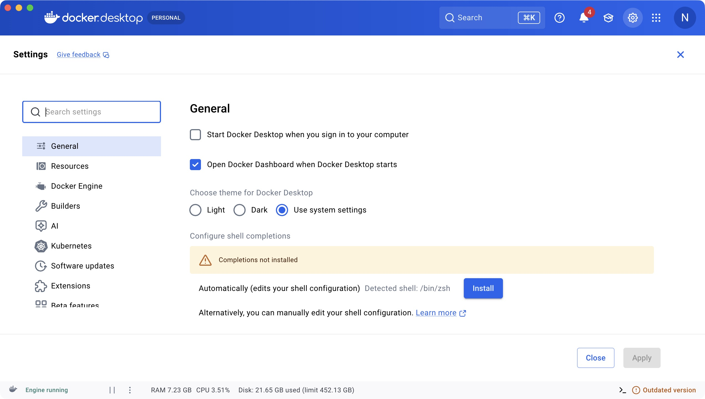
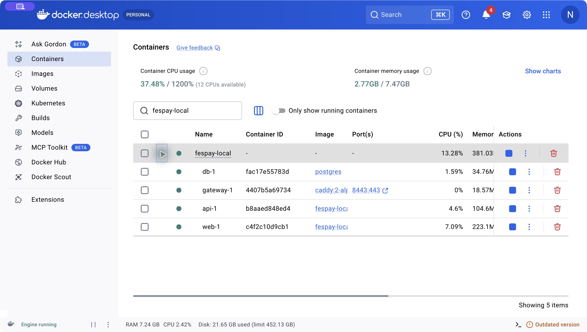
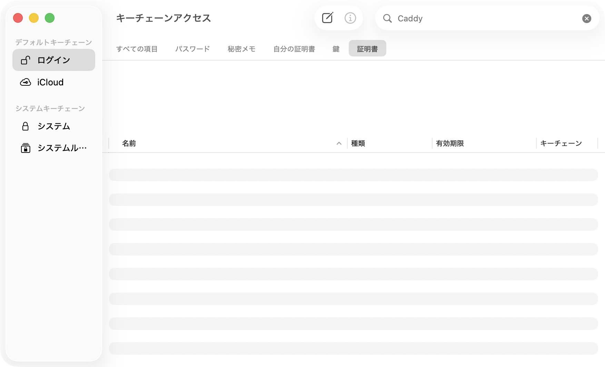

# FesPay ローカル開発スタートガイド

対象：初めて参加するチームメンバー。Windows・macOSを中心に、自分のPCでFesPayを起動するまでを説明します。更新日：2026-10-14。関連要件：DEV-02、ARC-02/03。窓口：natuki53。

本書は実際のアプリ・OSのスクリーンショットを使います。macOSの画面は2026-10-14に撮影し、Dockerは4.59.1です。この版のインストールを指定するものではなく、新規導入には公式の対応版を使ってください。Windowsの機能設定画像はDocker公式資料の例を使い、出典を明記しています。WindowsとmacOS、新旧バージョンでは外観が異なるので、本文の操作対象を確認してください。画面内の使用量は撮影PC全体の値で、FesPayだけの必要メモリではありません。

## まず、この２つを区別する

| 環境 | 使う場面 | URL | データ |
| --- | --- | --- | --- |
| 自分のPC（local） | 編集と動作確認 | `https://localhost:8443` | 自分のPC専用 |
| 共有ステージング | メンバー共通の結合確認 | `https://fespay-staging.mu-natuki.com` | 管理担当が配置する共通DB |

この手順で操作するのは**自分のPCのlocal環境**です。共有ステージングのサーバー接続やパスワードは初回導入には不要です。各PCのデータは共有サーバーへ自動的に送られません。

ゴールは、ブラウザーで `https://localhost:8443` が開き、`https://localhost:8443/health/ready` に `{"status":"ok"}` が表示されることです。現在の画面は「FesPay」「イベント決済のサービスを準備しています。」という基盤画面です。公開登録・ログイン・決済画面の完成を示すものではありません。

準備 → コード取得 → local起動 → 証明書登録 → ブラウザー確認の順に進めます。各節の「成功の目印」で、先へ進んでよいか確認します。

## 目次

1. [準備する](#1-準備する)
2. [コードを取得する](#2-コードを取得する)
3. [Dockerで起動する](#3-dockerで起動する)
4. [HTTPSの証明書を登録する](#4-httpsの証明書を登録する)
5. [ブラウザーで動作確認する](#5-ブラウザーで動作確認する)
6. [２回目以降と日々の作業](#6-２回目以降と日々の作業)
7. [困ったときの対処](#7-困ったときの対処)
8. [質問するときに送るもの](#8-質問するときに送るもの)

## 1. 準備する

用意するものはGit、Docker、ブラウザー、コードを編集するエディターです。**Dockerで起動するだけなら、PCへのNode.js・npm・PostgreSQLの個別インストールは不要です。** 開発の型チェックや統合試験を自分で実行する段階では、[開発手順](development.md)の追加ツールを用意してください。

初回はイメージや依存物をダウンロードします。ネット接続とディスクの空きを確保し、ダウンロード・buildの進行中は完了まで待ってください。所要時間はPCと回線によって変わります。

### Windows

1. [Git for Windows公式ページ](https://git-scm.com/install/windows)から、PCのCPUに合うインストーラーを取得・実行します。インストール後にPowerShellを開き直します。
2. [Docker Desktop公式のWindows導入ページ](https://docs.docker.com/desktop/setup/install/windows-install/)で対応OS・CPU・WSL要件を確認し、インストーラーを実行します。Intel/Ryzenの通常のPCはx86_64版です。
3. WSL 2が必要と言われた場合は、[MicrosoftのWSL導入手順](https://learn.microsoft.com/ja-jp/windows/wsl/install/)に沿って設定します。未導入なら、管理者として開いたPowerShellで次を実行し、案内に従って再起動します。この管理者操作はWSLの準備用です。

   ```powershell
   wsl --install
   ```

   WSLの準備で「Windowsの機能」を確認する必要がある場合の公式資料の画面例です。

   

   出典：[Docker公式ドキュメントの画像](https://github.com/docker/docs/blob/main/content/manuals/desktop/images/wsl2-enabled.png)。英語版・旧版の画面例です。赤丸は「仮想マシンプラットフォーム」「Linux用Windowsサブシステム」に対応します。通常は上のWSL導入手順で準備し、ほかのチェック状態は画像からコピーしません。

4. Docker Desktopを起動します。インストーラーでバックエンドを選ぶ場合はWSL 2を使い、**Linuxコンテナー**で動かします。利用条件やOSの許可は本人が確認して進めてください。
   既存インストールの設定を確認するときは、右上の歯車 → **Settings → General** を開き、表示される版では **Use WSL 2 based engine** を確認します。現在の版では既に有効なため項目自体が表示されない場合もあります。この手順ではWindowsのPowerShellから実行するので、WSLディストリビューションごとのIntegration設定を追加する必要はありません。[DockerのWSL設定説明](https://docs.docker.com/desktop/features/wsl/)

5. 通常のPowerShellを開き、以下を１行ずつ実行します。以後、この手順ではGit BashやWSLのターミナルと混ぜず、WindowsのPowerShellを使います。

   ```powershell
   git --version
   docker --version
   docker compose version
   docker info --format '{{.OSType}}'
   ```

成功の目印：Git/Docker/Composeの版が表示され、最後が `linux` になること。`docker --version` だけではDocker本体の起動確認にならないため、最後のコマンドまで確認します。

### macOS

1. ターミナルで `git --version` を実行します。Gitが使えない場合は [Git公式のmacOS案内](https://git-scm.com/install/mac)のXcode Command Line Toolsの方法を利用できます。

   ```bash
   xcode-select --install
   ```

2. Appleメニューの「このMacについて」でCPUを確認します。「チップ」がAppleのMシリーズならApple silicon、「プロセッサ」がIntelならIntel版です。
3. [Docker Desktop公式のmacOS導入ページ](https://docs.docker.com/desktop/setup/install/mac-install/)から対応する版を取得します。dmgを開き、DockerをApplicationsへ移して起動します。利用条件やOSの許可は本人が確認して進めます。
4. 右上の歯車からSettingsを開けます。下の画像はmacOSのGeneral画面です。自動起動は任意で、画像にあるInstall（シェル補完）やテーマの変更はFesPayの起動には不要です。通常は初期設定のまま進めます。

   

5. ターミナルを開き直して、以下を実行します。

   ```bash
   git --version
   docker --version
   docker compose version
   docker info --format '{{.OSType}}'
   ```

成功の目印はWindowsと同じで、最後が `linux` になることです。

### Linux

[Docker Engine公式の導入案内](https://docs.docker.com/engine/install/)で自分のディストリビューションを選び、Compose pluginも導入します。`docker compose version` と `docker info --format '{{.OSType}}'` が通ったら、以後のmacOS/Linux用コマンドを使ってください。権限の問題は導入担当へ確認し、この手順の途中で秘密ファイルをroot所有にしないようにします。

## 2. コードを取得する

`clone` はGitHub上のコードを自分のPCへ取得する操作です。既にFesPayの作業フォルダーがある人は二重にcloneせず、そのフォルダーで `git status` を確認します。変更が残っている場合は、担当へ確認してからbranchを切り替えてください。

### Windows：新しく取得する場合

PowerShellで実行します。保存場所はOneDriveの同期対象を避け、ここではユーザーフォルダー直下の `Projects` を使います。

```powershell
New-Item -ItemType Directory -Force "$env:USERPROFILE\Projects" | Out-Null
Set-Location "$env:USERPROFILE\Projects"
git clone https://github.com/fespay-team/fespay.git
Set-Location .\fespay
Get-Location
Test-Path .\scripts\docker-env.ps1
```

### macOS/Linux：新しく取得する場合

```bash
mkdir -p ~/Projects
cd ~/Projects
git clone https://github.com/fespay-team/fespay.git
cd fespay
pwd
ls scripts/docker-env.sh
```

成功の目印：現在地の末尾が `fespay` で、Windowsでは最後が `True`、macOS/Linuxではスクリプトのパスが表示されること。ここが**リポジトリのルート**です。以後のコマンドはこのフォルダーで実行します。

### Docker設定がまだmainにない場合だけ

Docker設定は [PR #34](https://github.com/fespay-team/fespay/pull/34)で取り込み対象です。`Test-Path` が `False`、またはスクリプトが見つからない場合、まずPRのマージ状態を確認してください。

- PR #34が未マージ：新しくcloneしたフォルダーで、次の２行を実行して設定を試せます。この段階で業務の実装ブランチをmainから開始しないでください。
- マージ済み：変更のない `main` で `git pull --ff-only` して、もう一度ファイルの有無を確認します。削除済みの作業ブランチを再作成する必要はありません。

```bash
git fetch origin
git switch --track origin/docker-team-environments
```

この２行はPowerShellでも同じです。`already exists` となる既存checkoutでは `git switch docker-team-environments` を使います。変更中のファイルを強制的に上書きする操作は行いません。

## 3. Dockerで起動する

Docker Desktopを起動した状態で、以下の**自分のOSの方だけ**を実行します。

Windows／PowerShell：

```powershell
.\scripts\docker-env.ps1 -Mode local -Action up
```

macOS/Linux／ターミナル：

```bash
./scripts/docker-env.sh local up
```

このコマンドは初回に設定と別々の秘密値を生成し、DBを準備してからAPI・Web・HTTPS入口を起動します。既存設定をコピーしたり、DBを手動で作成したりする必要はありません。**画面に出たパスワードを入力する工程もありません。** `setup` の再実行で資格情報を作り直そうとしないでください。

ログ中に `Building`、`Pulling`、`Downloading` が出ている間は処理中です。終了して入力できる状態に戻ったら、次で確認します。

Windows：

```powershell
.\scripts\docker-env.ps1 -Mode local -Action status
```

macOS/Linux：

```bash
./scripts/docker-env.sh local status
```

Docker Desktopで確認する場合は、左の **Containers** を開き、一覧の検索欄へ `fespay-local` と入力します。行の左の矢印を押して展開します。



画像の確認ポイント：

- 左下の **Engine running**：Docker本体が起動している。
- `fespay-local` の下の **db-1／gateway-1／api-1／web-1**：４サービスが見えている。
- 各行の緑の状態表示：稼働中。ただしhealthyの判定は上の `local status` でも確認する。
- gatewayの **8443:443**：PCの8443からHTTPS入口へ接続する。GUIのリンクがHTTPで開く場合があるため、ブラウザーへは本文の `https://localhost:8443` を直接入力する。
- コンテナーID・使用量・起動時間はPCによって異なる。撮影PCの使用量を合わせる必要はない。

成功の目印：サービス `db`・`api`・`web`・`gateway` の４つが `Up` かつ `healthy` であること。表の見え方はComposeの版で変わります。`migrate` は適用後に終了する作業用コンテナーなので、常時起動する５つ目のサービスではありません。

## 4. HTTPSの証明書を登録する

ローカルHTTPS用の証明書は自分のDockerが生成します。ブラウザーへ「自分の開発用CAを信頼する」と登録すると、警告を通り抜けずにHTTPSで確認できます。**他のメンバーの証明書や秘密CAを使わず、自分のPCで取り出した公開CAだけを登録します。** ここではOSの設定を本人が操作します。

### 4-1. 公開CAを取り出す

Windows：

```powershell
.\scripts\docker-env.ps1 -Mode local -Action certificate
Resolve-Path .\.tmp\fespay-local-root.crt
```

macOS/Linux：

```bash
./scripts/docker-env.sh local certificate
ls -l .tmp/fespay-local-root.crt
```

成功の目印：`fespay-local-root.crt` が存在すること。Windowsの `Resolve-Path` が表示したフルパスは、次のファイル選択で使います。

### 4-2. Windowsで登録

1. `Windows + R` を押し、`certmgr.msc` と入力して開きます。これは「現在のユーザー」の証明書管理です。
2. 左側の「信頼されたルート証明機関」を展開し、その下の「証明書」を選びます。
3. 「証明書」を右クリックし、「すべてのタスク」→「インポート」を選びます。
4. ファイル選択で、4-1のフルパスを指定します。拡張子のフィルターで見つからない場合は「すべてのファイル」に切り替えます。
5. 保存先を「信頼されたルート証明機関」に指定して進めます。表示されたCAが自分のPCから取り出したものと確認し、本人が信頼の登録を完了します。
6. Chrome/Edgeをすべて終了して開き直します。

端末管理の制約で登録できない場合は管理担当へ相談します。Windowsの証明書管理については [Microsoftの現在のユーザーの証明書ストア説明](https://learn.microsoft.com/en-us/dotnet/framework/wcf/feature-details/how-to-view-certificates-with-the-mmc-snap-in)も参照できます。

### 4-3. macOSで登録



この画像は**CAを登録する前**の画面です。左で「ログイン」、上で「証明書」を選び、検索欄へ `Caddy` と入力すると対象を探せます。未登録なら画像のように一覧が空です。メニューバーの「ファイル」→「読み込む…」から次の手順で登録します。撮影時には証明書を取り込まず、OSの信頼設定も変更していません。

1. `Command + Space` でSpotlightを開き、「キーチェーンアクセス」を検索します。「パスワード」アプリではなく、キーチェーンアクセスを開きます。
2. 「ログイン」キーチェーンを選び、「ファイル」→「読み込む…」を使います。ファイル選択で `Command + Shift + G` を押し、`~/Projects/fespay/.tmp` を指定すると、隠しフォルダーへ移動できます。別の場所へcloneした場合は、その場所の `.tmp` を指定します。
3. `fespay-local-root.crt` を取り込みます。取り込んだCA（Caddy Local Authorityを含む名前）をダブルクリックします。
4. 「信頼」を展開し、SSLの項目を「常に信頼」に設定します。内容を確認して閉じ、OSが求めた認証は本人が行います。
5. ブラウザーをすべて終了して開き直します。

信頼項目の操作は [Apple公式の証明書の信頼設定](https://support.apple.com/ja-jp/guide/keychain-access/kyca11871/mac)を参照してください。UIに個別のSSL設定がないなど版による違いがある場合は、登録先と対象CAを管理担当と確認します。

### 4-4. Linuxで登録

取得した公開CAを、自分のディストリビューションとブラウザーが使う信頼ストアへ登録します。OS/ブラウザーによって登録先が異なるため、環境名を添えて担当へ確認してください。登録が済むまでは、この手順のHTTPS確認は未完了です。

## 5. ブラウザーで動作確認する

ChromeまたはEdgeで、URLを上から順に開きます。検索欄への文字検索ではなく、アドレス欄に `https://` を含むURLを入力してください。

| 開くURL | 成功の目印 | 確認していること |
| --- | --- | --- |
| `https://localhost:8443` | FesPayの基盤画面が表示される | WebとHTTPS入口 |
| `https://localhost:8443/health/live` | `{"status":"ok"}` | APIが動いている |
| `https://localhost:8443/health/ready` | `{"status":"ok"}` | APIから適用済みDBへ接続できる |

JSONは１行または整形表示で出ますが、内容が同じなら正常です。３つとも確認できたら初回導入は完了です。local環境で共有ステージング用のBasic認証は求められません。

API確認の例として `https://localhost:8443/v1/auth/context` を開くと、未ログイン時は `authentication_stage` が `ANONYMOUS` です。未ログインで保護されたAPIを開いたときの401は、DBやDockerの故障とは限りません。

## 6. ２回目以降と日々の作業

### 作業開始・終了のコマンド一覧

毎回Docker Desktopを起動し、前回の `fespay` フォルダーへ移動します。

| やりたいこと | Windows／PowerShell | macOS/Linux |
| --- | --- | --- |
| 起動・依存変更後の再build | `.\scripts\docker-env.ps1 -Mode local -Action up` | `./scripts/docker-env.sh local up` |
| 状態を見る | `.\scripts\docker-env.ps1 -Mode local -Action status` | `./scripts/docker-env.sh local status` |
| 直近のログを見る | `.\scripts\docker-env.ps1 -Mode local -Action logs` | `./scripts/docker-env.sh local logs` |
| 終了する | `.\scripts\docker-env.ps1 -Mode local -Action down` | `./scripts/docker-env.sh local down` |

`down` でDBとCAの保存領域は残るため、次の `up` で再利用できます。通常の終了に `down -v` やDocker Desktopのvolume削除を使わないでください。DBとCAが失われ、再設定が必要になります。

### チームでコードを変更する流れ

Docker設定がmainへマージ済みになった後の例です。GitHubへのpushはチームの権限が必要です。まだ設定確認用ブランチを使っている場合は、先に担当へ切替時期を確認します。

初めてコミットする前に、以下で作者名とメールの設定を確認します。何も表示されない項目があれば、自分の値を設定します。これはこのリポジトリだけの設定です。

```bash
git config user.name
git config user.email
```

次の２行は、引用符内を**自分の表示名とコミット用メールアドレスに書き換えてから**実行します。メールを公開したくない場合は、GitHubのSettings → Emailsで自分のnoreplyアドレスを確認して使います。設定はpush権限の取得やGitHubへのログインとは別です。

```bash
git config --local user.name "あなたの表示名"
git config --local user.email "あなたのコミット用メールアドレス"
```

1. `git status` で変更を確認します。変更があれば先にコミットするか担当へ相談し、強制的に捨てないでください。
2. 変更のない状態でmainを更新し、自分の作業ブランチを作ります。以下の `feature/my-task` は例です。チームで決めたIssue・作業名に合わせたbranch名に置き換えます。

   ```bash
   git switch main
   git pull --ff-only
   git switch -c feature/my-task
   ```

3. localを起動し、エディターで対象ファイルを変更・保存します。FEは `apps/web/src`、APIは `apps/api/src` です。通常は保存後に画面やAPIへ反映されます。依存・Dockerfile・DB migrationを変更した場合は `local up` を再実行します。既に適用したmigrationファイルは直接書き換えず、新しいmigrationとしてレビューします。
4. ブラウザーで変更箇所を確認します。必要な型・build・単体/統合試験は [開発手順](development.md)に従います。基盤の起動成功だけで変更した機能の検証を完了扱いにしません。
5. `git diff` と `git status` で対象を確認し、変更したファイルだけを追加します。下は `apps/web/src/main.tsx` を変更した場合の例です。追加するファイルとコミットの説明を自分の変更に合わせます。

   ```bash
   git add apps/web/src/main.tsx
   git diff --cached --check
   git commit -m "feat: 変更内容を日本語で説明"
   git push -u origin HEAD
   ```

6. GitHubでPRを作成し、Issue・変更理由・確認結果を記載します。作者以外のレビューを受けて取り込みます。[チーム開発ガイド](../../CONTRIBUTING.md)のレビュー手順を使ってください。

`.env.docker.local`、`secrets`、CAの秘密鍵、生成物は共有・コミットしません。localから共有ステージングへは自動配置されません。ステージングへの反映は管理担当へ依頼します。

## 7. 困ったときの対処

| 症状 | 最初に確認・実行すること |
| --- | --- |
| `git` / `docker` が見つからない | インストールを確認し、ターミナルを開き直す。まだ解決しなければPATH設定を担当と確認 |
| Docker daemonへ接続できない | Docker Desktopを起動し、起動完了後に `docker info --format '{{.OSType}}'` を再実行 |
| スクリプトが見つからない | 現在地の末尾が `fespay` か、手順2のファイル確認とPR #34の取り込み状態を確認 |
| PowerShellで実行禁止と表示 | 下の「PowerShellの実行ポリシー」を参照 |
| macOS/Linuxで `Permission denied` / 改行エラー | `bash ./scripts/docker-env.sh local up` で確認。別のスクリプトで失敗する場合や `\r` が出る場合は取得元・改行設定を担当と確認 |
| `already exists; credentials will not be overwritten` | `setup` ではなく `local up` を使う。envを削除して再生成しない |
| `port is already allocated` / 8443使用中 | 自分の別のFesPay環境が起動していないか確認。下の「ポートを変更する」を参照 |
| 証明書の警告が消えない | そのPCのCAか、登録先、ブラウザーの再起動、URLがlocalhostかを確認。警告を通過せず手順4へ戻る |
| localhostに接続できない | `local status` で４サービスが起動しているか確認し、`local logs` のエラーを読む |
| readyが `unavailable` / 503 | DB/APIの状態とログを確認。`local up` で適用と起動を再確認。資格情報不一致・checksumエラーは下記へ |
| `password authentication failed` | envと既存DBの組み合わせが違う可能性。envやvolumeを削除せず担当へ相談 |
| migrationのchecksumエラー | 適用済みSQLが変わっていないか確認。履歴テーブルやchecksumを手動修正しない |
| 更新後も古い画面 | 編集フォルダーと起動中のcheckoutが同じか確認し、ブラウザー再読込。依存変更後は `local up` |
| Gitのpull/switchが失敗 | `git status` で変更と現在のbranchを確認。force操作で回避せず担当へ相談 |
| `Author identity unknown` | 上の作者名・メールの設定を確認してからコミットを再実行 |
| pushで認証・権限エラー | GitHubへログインしている本人のアカウントとチームのWrite権限を確認。認証画面は本人が操作し、パスワードやtokenをチャットへ送らない |

### PowerShellの実行ポリシー

自分の個人開発PCで、取得したスクリプトを確認したうえで実行を許可する場合だけ、**今開いているPowerShellに限定して**次を設定し、起動コマンドを再実行します。PowerShellを閉じるとこの設定は終了します。

```powershell
Set-ExecutionPolicy -Scope Process -ExecutionPolicy RemoteSigned
```

[Microsoftの説明](https://learn.microsoft.com/ja-jp/powershell/module/microsoft.powershell.security/set-executionpolicy?view=powershell-7.5)にあるように、組織のポリシーが優先する場合はこの指定で変更できません。管理されたPCでは管理担当へ相談し、強制的な回避設定は使いません。

### ポートを変更する

8443が別アプリで使われているときは、そのアプリを勝手に停止せず、FesPayの設定を変えます。

1. エディターで `.env.docker.local` を開きます。秘密値が含まれるので画面共有・スクリーンショットへ写さないでください。
2. 次の２項目だけ、例えば8444へ合わせます。他の値は変えません。

   ```dotenv
   FESPAY_HTTPS_PORT='8444'
   APP_ORIGIN='https://localhost:8444'
   ```

3. `local up` を再実行し、以後はブラウザーで `https://localhost:8444` を開きます。`/health/ready` も同じポートです。CA volumeを保持していれば、ポート変更だけでCAを作り直す必要はありません。

複数のcheckoutを同時起動すると、既定のCompose project名 `fespay-local` が共通になり、同じ環境を操作する可能性があります。初参加者は１つのcheckoutで作業し、複数環境が必要な場合は担当とproject名・ポートの分離を決めてください。

## 8. 質問するときに送るもの

以下を添えると、どこで止まったか確認しやすくなります。

- OSと版、Intel/AMD/Apple siliconの区別。
- この手順の番号、実行したコマンド、最後のエラーメッセージ。
- `git branch --show-current` と `git rev-parse --short HEAD` の結果。
- `docker compose version` と `local status` の結果。
- `local logs` の該当エラー前後。秘密値・Cookie・tokenが写っていないことを確認する。

envファイル全文、パスワード、秘密鍵、認証Cookieは送らないでください。症状確認のために環境を初期化する必要がある場合も、まず残すデータと復旧手順を担当と決めます。

## 初回完了チェック

- [ ] Docker本体へ接続でき、Linuxコンテナーとして動いている。
- [ ] 正しいFesPayフォルダーとDocker設定のあるbranchを使っている。
- [ ] db/api/web/gatewayが正常に起動した。
- [ ] 自分のPCが生成した公開CAを登録し、ブラウザーを開き直した。
- [ ] HTTPSの画面、live、readyを確認できた。
- [ ] 終了方法、秘密値の扱い、質問先が分かった。

本書のコマンドと期待値はPR #34の実装を基準に確認しています。Windows実機のDocker DesktopとOSの証明書登録UIは未検証です。macOSのDocker画面・証明書管理の登録前画面、Windowsの公式資料の画面例と、Windows実機での検証を区別します。画像の出典・撮影条件は[画像一覧](assets/docker-start/README.md)に記載しています。
